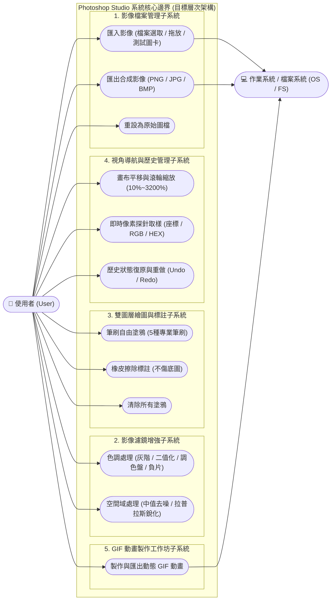
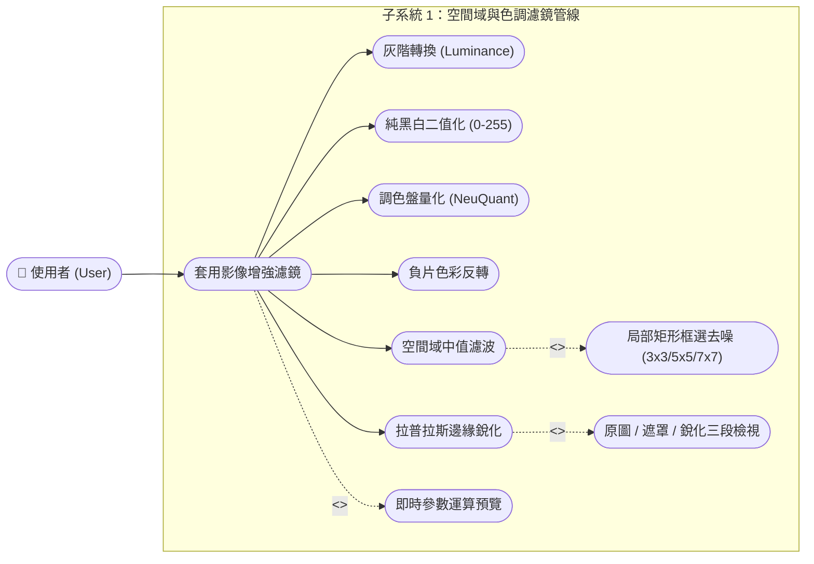
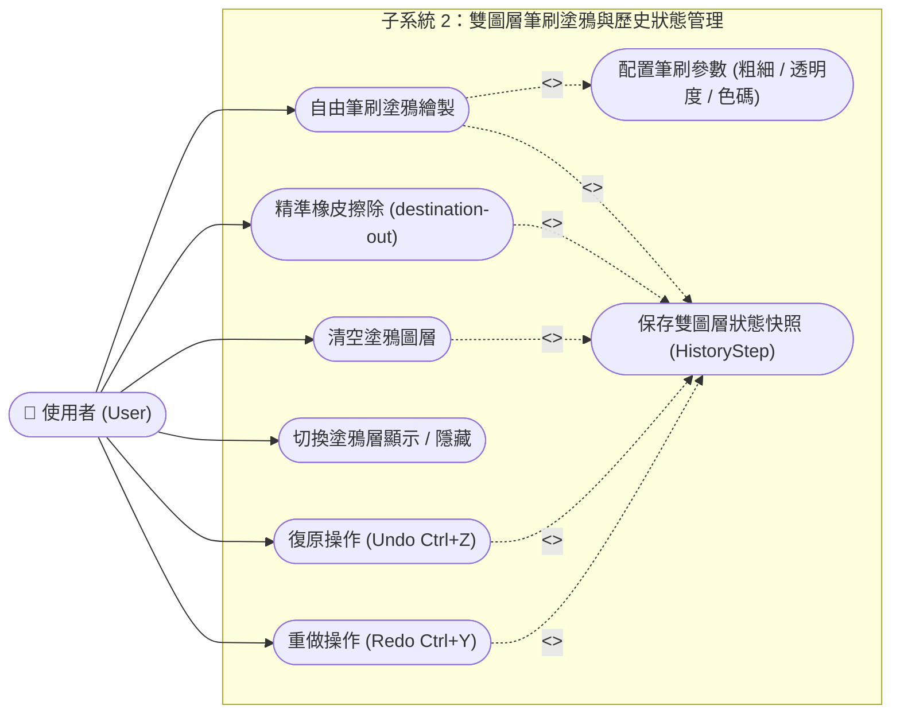
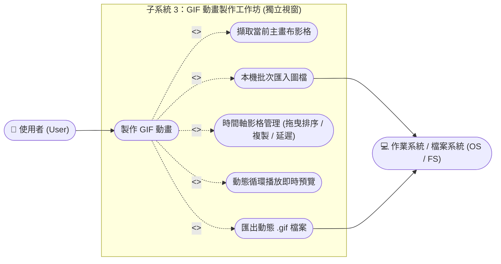
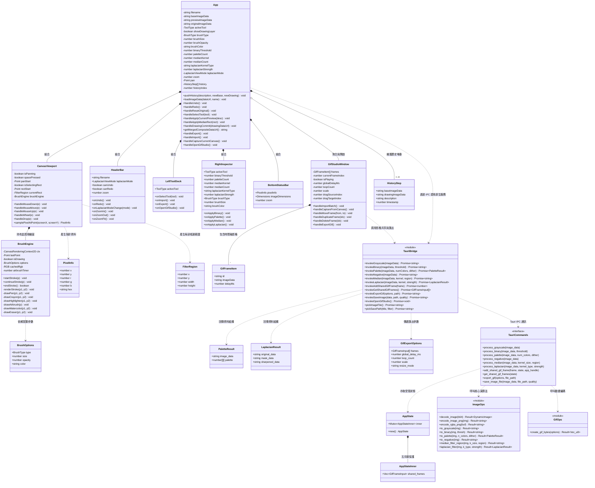
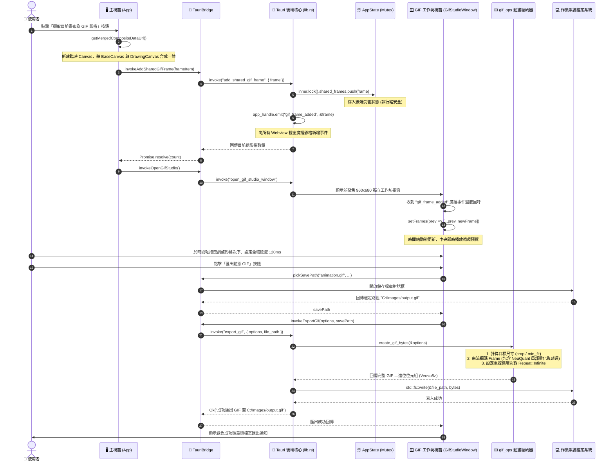

# Photoshop Studio 專案 UML 架構規格與模型圖集

> **專案定位**：基於 **Tauri v2 + Rust + React 18 + TypeScript + Vite + Tailwind CSS** 建構之旗艦級 Windows 桌面影像編輯器。  
> **建模標準**：遵循 **OMG UML 2.5.1** 規範與軟體架構視覺化原則，支援 Mermaid 內嵌即時渲染與 PlantUML 原始碼匯出。

---

## 📌 建模背景與視覺化架構決策 (Modeling Decisions)

| 決策項目 | 選定方案 | 備選方案 (Fallback) | 決策依據與工程考量 |
|---|---|---|---|
| **使用者案例圖 (Use Case Diagram)** | Mermaid Flowchart (具備系統邊界與標準語義) | PlantUML UseCase | 清楚劃定系統邊界 (System Boundary)，分離主參與者 (使用者) 與次參與者 (作業系統檔案系統)，標記 `<<include>>` 與 `<<extend>>`。 |
| **類別圖 (Class Diagram)** | Mermaid Class Diagram (分層式結構) | PlantUML Class | 分為前端展示層 (React)、引擎與橋接層 (TypeScript)、後端運算層 (Rust)，揭示屬性、方法、型別與依賴關係。 |
| **循序圖 (Sequence Diagram)** | Mermaid Sequence Diagram (3大關鍵情境) | PlantUML Sequence | 針對「影像濾鏡非同步運算與套用」、「雙圖層筆刷繪圖與 Undo/Redo 歷史管理」、「GIF 工作坊跨視窗 IPC 與串流匯出」繪製時序互動。 |

---

## 一、使用者案例圖 (Use Case Diagram)

### 1.1 需求層次化劃分原則 (Goal-Oriented Decomposition)
為了避免傳統單一全景圖中「20 餘個細部案例與多個參與者之間連線交錯穿插、視覺雜亂」的反模式，本專案依據 **UML 2.5.1 標準軟體工程方法論**，採用「**全景目標總覽 (Level 1) + 核心子系統細部分解 (Level 2)**」的清晰分層架構：
1. **Level-1 系統全景圖 (Overview)**：僅呈現使用者的核心目標（Primary Goals）與系統五大核心模組，消除多餘交叉線，視覺清晰純淨。
2. **Level-2 子系統細化圖 (Subsystem Decomposition)**：
   - **子系統一 (影像濾鏡管線)**：聚焦濾鏡泛化、即時運算預覽 `<<include>>` 與局部矩形框選 `<<extend>>`。
   - **子系統二 (雙圖層塗鴉與歷史)**：聚焦筆刷繪製、`destination-out` 橡皮擦、參數設定 `<<extend>>` 與歷史快照保存 `<<include>>`。
   - **子系統三 (GIF 動畫工作坊)**：聚焦時間軸管理、畫布擷取、多圖匯入與串流編碼匯出。

---

### 1.2 系統全景使用者案例圖 (Level-1 Overview)

> **特點**：主參與者（使用者）位於左側，次參與者（作業系統檔案系統）位於右側，五大模組分區明確，線條零交錯。



---

### 1.3 核心子系統細部案例圖 (Level-2 Subsystem Detail)

#### A. 空間域與色調濾鏡管線 (Image Enhancement Pipeline)
展示各項濾鏡的選擇泛化、即時運算預覽的包含關係，以及中值去噪框選與拉普拉斯三段檢視的擴充關係：



#### B. 雙圖層筆刷塗鴉與歷史狀態管理 (Drawing & History Stack)
展示繪圖層獨立渲染、橡皮擦精準擦除、參數微調擴充與雙圖層歷史快照自動保存的包含關係：



#### C. GIF 動畫製作工作坊 (GIF Studio Workshop)
展示獨立子視窗環境下的畫布影格擷取、外部圖檔批次匯入、時間軸管理與串流匯出流程：



---

## 二、類別圖 (Class Diagram)

### 2.1 架構分層說明
本專案為標準的三層架構（展示層、引擎與橋接層、後端原生核心運算層）：
1. **展示層 (Presentation Layer - React Components)**：
   - `App`：主應用程式中樞，負責整體全域狀態協調、工具切換、歷史堆疊管控。
   - `CanvasViewport`：雙畫布渲染容器 (`BaseCanvas` 與 `DrawingCanvas`)，掌管滑鼠平移縮放事件、筆刷事件派送、局部去噪框選與像素懸浮探針。
   - `HeaderBar`：頂部導航與檔案資訊、拉普拉斯檢視模式分段切換、Undo/Redo 觸發。
   - `LeftToolDock`：左側工具列，負責工具選取與子視窗喚起。
   - `RightInspector`：右側動態屬性檢查器，依當前啟用工具動態展示參數滑桿與控制元件。
   - `BottomStatusBar`：底部即時狀態列，呈現像素值、座標與縮放倍率。
   - `GifStudioWindow`：獨立之 GIF 動畫工作坊視窗元件。
2. **領域引擎與資料橋接層 (Core Engine & Bridge Layer - TypeScript)**：
   - `BrushEngine`：筆刷渲染核心類別，封裝鋼筆、粗糙蠟筆、半透明螢光筆、計時噴槍、水彩筆與橡皮擦演算法。
   - `TauriBridge`：靜態/非同步函式庫，封裝與 Rust 後端通訊之 `invoke` 指令與檔案對話框。
   - 核心型別合約 (`HistoryStep`, `PixelInfo`, `BrushOptions`, `FilterRegion`, `PaletteResult`, `LaplacianResult`, `GifFrameItem`, `GifExportOptions`)。
3. **原生高效運算層 (Native Backend Layer - Rust / Tauri Core)**：
   - `AppState` / `AppStateInner`：後端執行緒安全受管狀態，以 `Mutex` 保護跨視窗共享之影格資料。
   - `ImageOps`：無狀態影像演算法模組，包含灰階權重轉換、二值化、`color_quant::NeuQuant` 色彩量化、中值排序去雜訊、拉普拉斯邊緣二階微分等。
   - `GifOps`：串流式 GIF 編碼器模組，支援縮放、尺寸適配與全域/逐格延遲控制。
   - `TauriCommands`：註冊於 `lib.rs` 的 IPC 入口函式。

### 2.2 Mermaid 類別圖



---

## 三、循序圖 (Sequence Diagram)

### 3.1 循序圖一：影像濾鏡非同步計算與預覽套用流程

> **設計亮點**：展示使用者滑動參數滑桿時，前端透過 `isCancelled` 旗標防止網路/IPC 非同步回應交錯引起的競態條件 (Race Condition)，並透過 Base64 資料交換完成即時預覽與歷史確認套用。

```mermaid
sequenceDiagram
    autonumber
    actor User as 👤 使用者
    participant Inspector as 🖥️ RightInspector
    participant App as ⚛️ App 控制核心
    participant Bridge as 🌉 TauriBridge
    participant TauriCmd as 🦀 TauriCommand (lib.rs)
    participant RustCore as ⚙️ image_ops 影像核心
    participant Viewport as 🎨 CanvasViewport (BaseCanvas)

    User->>Inspector: 拖動二值化閾值滑桿 (Threshold = 180)
    Inspector->>App: 觸發 onBinaryThresholdChange(180)
    
    rect rgb(30, 41, 59)
        note over App: 建立非同步取消旗標 (isCancelled = false)
        App->>Bridge: invokeBinary(baseImageData, 180)
        Bridge->>TauriCmd: invoke("process_binary", { image_data, threshold: 180 })
        
        TauriCmd->>RustCore: decode_image(&image_data)
        RustCore-->>TauriCmd: DynamicImage 實例
        TauriCmd->>RustCore: to_binary(&img, 180)
        note over RustCore: 遍歷像素矩陣計算亮度 Y >= 180 ? 255 : 0<br/>使用 encode_rgba_png 零拷貝編碼
        RustCore-->>TauriCmd: 回傳 DataURL (data:image/png;base64,...)
        TauriCmd-->>Bridge: IPC 回傳 Base64 結果字串
        Bridge-->>App: Promise.resolve(previewUrl)
        
        opt 驗證取消旗標 (若使用者中途未再次拖動滑桿)
            App->>App: setPreviewImageData(previewUrl)
            App->>Viewport: 傳入 previewImageData
            Viewport->>Viewport: BaseCanvas 繪製預覽圖片
        end
    end

    User->>Inspector: 滿意預覽效果，點擊「套用變更」按鈕
    Inspector->>App: 觸發 onApplyBinary()
    App->>App: setBaseImageData(previewImageData)
    App->>App: setPreviewImageData(null)
    App->>App: setActiveTool('none')
    App->>App: pushHistory("套用純黑白二值化", previewImageData)
    note over App: 歷史堆疊新增步驟 (Unified History Step)
    App->>Viewport: 重新以 baseImageData 渲染底圖
```

---

### 3.2 循序圖二：雙圖層筆刷塗鴉繪製與歷史堆疊復原/重做流程

> **設計亮點**：底圖層 (`BaseCanvas`) 與繪圖層 (`DrawingCanvas`) 獨立運作。橡皮擦以 `destination-out` 擦除塗鴉，滑鼠釋放時提交增量快照至歷史堆疊。使用者按下 `Ctrl+Z` 時精準還原雙圖層畫面。

```mermaid
sequenceDiagram
    autonumber
    actor User as 👤 使用者
    participant Viewport as 🎨 CanvasViewport
    participant Engine as 🖌️ BrushEngine
    participant DrawingCanvas as 🖼️ DrawingCanvas (上層畫布)
    participant App as ⚛️ App 控制器
    participant History as 📚 歷史堆疊 (Unified History)

    User->>Viewport: 滑鼠於畫布按下 (MouseDown at P1)
    Viewport->>Engine: startStroke(P1)
    note over Engine: 記錄 lastPoint = P1, isDrawing = true
    Engine->>DrawingCanvas: renderStroke(P1, P1) 繪製起點圓點

    loop 滑鼠持續拖曳移動 (MouseMove)
        User->>Viewport: 滑鼠移動至 P2 (座標經 Zoom 與 Pan 逆轉換)
        Viewport->>Engine: continueStroke(P2)
        alt 筆刷類型為橡皮擦 (Eraser)
            Engine->>DrawingCanvas: 設定 globalCompositeOperation = "destination-out"
            Engine->>DrawingCanvas: 擦除上層塗鴉筆跡 (絲毫不傷底圖)
        else 筆刷類型為鋼筆 / 蠟筆 / 螢光筆
            Engine->>DrawingCanvas: 進行筆刷紋理插值與 Bezier 平滑渲染
        end
        Viewport->>App: onPixelHover(取樣合成畫面座標與色碼)
    end

    User->>Viewport: 釋放滑鼠按鈕 (MouseUp)
    Viewport->>Engine: endStroke()
    Engine-->>Viewport: 回傳 drewSomething = true
    Viewport->>DrawingCanvas: toDataURL("image/png")
    DrawingCanvas-->>Viewport: 取得塗鴉層 DataURL
    Viewport->>App: onDrawingCommit(drawingDataUrl)
    App->>History: pushHistory("繪製筆刷塗鴉", currentBase, drawingDataUrl)
    note over History: 歷史指標 index 推進至新步驟 (最多保留 30 階)

    rect rgb(45, 25, 30)
        note over User, History: 復原流程 (Undo Workflow)
        User->>App: 按下鍵盤快捷鍵 Ctrl + Z
        App->>App: handleUndo()
        App->>History: 讀取 history[index - 1]
        History-->>App: 回傳前一步驟快照 (prevBase, prevDrawing)
        App->>App: setBaseImageData(prevBase)
        App->>DrawingCanvas: clearRect(0, 0, width, height)
        App->>DrawingCanvas: drawImage(prevDrawing)
        App->>App: setHistoryIndex(index - 1)
        note over App: 畫布雙圖層狀態完全復原至塗鴉前
    end
```



---

### 3.3 循序圖三：GIF 動畫工作坊之畫布擷取、多視窗 IPC 廣播與匯出流程

> **設計亮點**：主視窗將底圖與塗鴉層合成完整畫面，透過 Tauri IPC 寫入全域狀態，後端發布 `gif_frame_added` 事件喚醒獨立工作坊視窗，最終以串流編碼器 (`gif::Encoder`) 輸出動態 GIF。



---

## 四、架構特徵與原始碼對應驗證表

| UML 模型實體 / 關聯 | 系統模組 / 原始碼位置 | 實作特性與驗證說明 |
|---|---|---|
| **雙圖層架構 (Dual-Canvas)** | `src/components/canvas/CanvasViewport.tsx` | 分設 `baseCanvasRef` 與 `drawingCanvasRef`，底層承載濾鏡運算，上層承載筆刷，互不干擾。 |
| **橡皮擦 destination-out** | `src/utils/brushEngine.ts` | `ctx.globalCompositeOperation = 'destination-out'`，僅精準清除透明塗鴉層，保護原圖無損。 |
| **統一歷史堆疊 (HistoryStep)** | `src/App.tsx` 與 `src/types/index.ts` | 上限 30 階，每個 Step 同時封裝 `baseImageData` 與 `drawingImageData`，達成完美復原/重做。 |
| **非同步防競態預覽** | `src/App.tsx` (L281-L341) | `useEffect` 內部配置 `isCancelled` 清理旗標，徹底消除滑動參數時的非同步 Race Condition。 |
| **高效能空間域與銳化** | `src-tauri/src/image_ops.rs` | 以純 Rust 實作 4-鄰域與 8-鄰域拉普拉斯矩陣微分、奇數窗口中值濾波與 `NeuQuant` 調色盤量化。 |
| **跨視窗影格廣播** | `src-tauri/src/lib.rs` 與 `src/components/gif/GifStudioWindow.tsx` | 透過 `app_handle.emit("gif_frame_added")` 實現 Tauri 多視窗 IPC 雙向同步。 |
| **零拷貝串流 GIF 編碼** | `src-tauri/src/gif_ops.rs` | 支援 `min_fit` 最小邊長自適應與串流式 `gif::Encoder`，避免多影格匯出時記憶體爆增。 |
